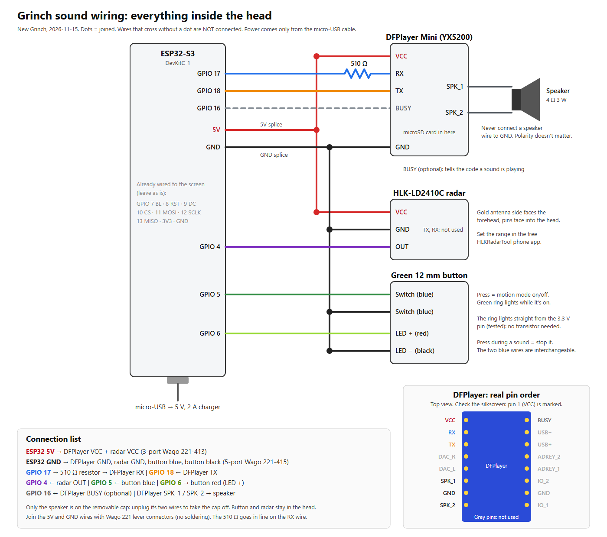

# Animated-Eye Grinch: firmware

[Download the complete PlatformIO firmware source](GrinchEyes-firmware.zip) and extract the ZIP before opening the project.

Firmware for the 3D-printed Grinch fan-art figure (model on MakerWorld: [PASTE MAKERWORLD LINK]).

A 2.8" screen behind the face shows animated eyes. An LD2410C radar notices someone walking up, and a DFPlayer Mini plays the next MP3 from a microSD card. The eyes turn angry while he talks. A green button on the back of the head controls motion mode and volume. A web page on your home Wi-Fi gives phone control.

## Hardware
- ESP32-S3-DevKitC-1 (N8R2 or N16R8)
- 2.8" ILI9341 SPI TFT, 240×320, 14-pin (touch pins not used)
- DFPlayer Mini + 40 mm 4 Ω 3 W speaker
- HLK-LD2410C radar
- 12 mm momentary button with LED ring
- microSD card (≤ 32 GB, FAT32)
- 1 kΩ resistor

## Wiring
| From | To ESP32-S3 |
|---|---|
| Screen VCC / GND | 3V3 / GND |
| Screen CS, RESET, DC | GPIO 10, 8, 9 |
| Screen SDI (MOSI), SCK, SDO (MISO) | GPIO 11, 12, 13 |
| Screen LED (backlight) | GPIO 7 |
| Radar VCC / GND / OUT | 5V / GND / GPIO 4 |
| DFPlayer VCC / GND | 5V / GND |
| DFPlayer RX | 1 kΩ resistor → GPIO 17 |
| DFPlayer TX | GPIO 18 |
| DFPlayer SPK_1 / SPK_2 | speaker |
| Button switch legs | GPIO 5 and GND |
| Button LED + / − | GPIO 6 / GND |

## Uploading
1. Install [VS Code](https://code.visualstudio.com/) and its **PlatformIO IDE** extension.
2. **File → Open Folder** and pick this folder.
3. Plug the ESP32 into its **UART/COM** USB port.
4. Click the **→ Upload** arrow in the blue bar at the bottom. The `eyes` program is the default.

   If it picks the wrong port, uncomment `upload_port` in `platformio.ini` and set your port.

`screen_test` is a simple colour test, useful for checking the screen wiring first. Choose it in the env selector.

## Sound card
1. Format the card FAT32.
2. Make a folder named `mp3`.
3. Add files named `0001.mp3`, `0002.mp3`, and so on. Words may follow the number, for example `0003_laugh.mp3`.

He plays the next file each time someone arrives and remembers his place after power-off. Normalize quiet clips instead of turning the volume up to 30, which distorts.

## Button
- **Tap:** motion mode on/off, or stop the sound that's playing.
- **Hold 1 s:** step the volume through 6 → 10 → 14 → 18 → 22 → 26 → 6, with a short preview. The volume is remembered.
- **Hold while plugging in:** forget the saved Wi-Fi.

## Phone control
1. On first start, join the Wi-Fi network **Grinch-Setup** (password `grinchsetup`). The setup page opens by itself, or browse to `192.168.4.1`.
2. Pick your home Wi-Fi (2.4 GHz only) and enter its password.
3. Back on your home Wi-Fi, open **http://grinch.local**. Some Android phones don't resolve `.local` names. If yours doesn't, type `w` in the Serial Monitor (115200 baud) to get the IP address.

The page offers:
- play any sound, stop, volume
- motion on/off
- eye mode (auto / angry / calm), look left/right, blink
- brightness
- a live status

It has no password, so anyone on your home Wi-Fi can open it.

## Tuning
In `src/eyes.cpp`:
- `EYE_L_*` / `EYE_R_*`: eye positions. Hold BOOT at power-up for calibration crosshairs.
- `ANGRY_INNER_PX`, `ANGRY_OUTER_PX`, `ANGRY_LOWER_PX`: how angry he looks while talking.
- `COOLDOWN_MS`: pause between sounds.
- `MAX_IN_A_ROW`: sounds per arrival. Keep it at 1 inside the closed head, because the radar can pick up the speaker's own vibration.
- `VOLUME`: first-start volume.

Radar: in the HLKRadarTool app (Bluetooth, password `HiLink`), set the detection range to 0–0.75 m and the unmanned duration to 1 s.

## Serial commands (115200 baud)
- `p`: play the next sound
- `+` / `-`: volume up / down
- `w`: Wi-Fi status and IP address

## Note
The Grinch is a character owned by Dr. Seuss Enterprises. This is a non-commercial fan project. No sound clips are included.

